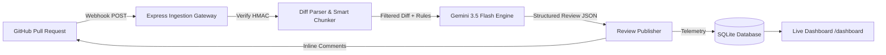

# 🤖 Autonomous AI PR Reviewer Bot

[](https://www.typescriptlang.org/)
[](https://nodejs.org/)
[](https://ai.google.dev/)
[](https://sqlite.org/)

An enterprise-grade, event-driven GitHub App that performs automated, high-signal code reviews on Pull Requests using **Google Gemini 3.5 Flash**. 

Built with production systems design: HMAC webhook verification, intelligent unified diff chunking, noise suppression, per-repo YAML configuration, and a built-in observability dashboard.

---

## 🌟 Key Features

- **⚡ Event-Driven Ingestion:** Listens to GitHub webhook events (`pull_request.opened`, `synchronize`, `reopened`) via HMAC SHA-256 signature verification.
- **🧠 Senior Engineer AI Reviews:** Powered by Gemini 3.5 Flash with structured JSON schemas to identify security vulnerabilities, logic bugs, and race conditions.
- **💬 Inline GitHub Comments:** Places reviews directly on the modified code lines with severity tags (`CRITICAL`, `SUGGESTION`, `NIT`).
- **📦 Smart Diff Chunking & Filtering:** Automatically skips lockfiles (`package-lock.json`), minified bundles, and images; partitions large PRs to prevent context degradation.
- **⚙️ Custom Repository Config:** Supports `.reviewbot.yml` in target repositories for custom rules, ignore patterns, and severity thresholds.
- **📊 Real-Time Observability Dashboard:** Built-in web UI at `/dashboard` tracking latency, bug counts, and review histories backed by SQLite.

---

## 🏗️ Architecture



---

## 🚀 Quickstart

### 1. Clone & Install
```bash
git clone <repo-url>
cd "PR Reviwer Bot"
npm install
```

### 2. Configure Environment
Create a `.env` file from `.env.example`:
```env
GITHUB_APP_ID=your_github_app_id
GITHUB_PRIVATE_KEY_PATH=./private-key.pem
GITHUB_WEBHOOK_SECRET=your_webhook_secret
GEMINI_API_KEY=your_gemini_api_key
PORT=3000
NODE_ENV=development
SMEE_URL=https://smee.io/your_channel
```

### 3. Run Development Server
```bash
npm run dev
```

Visit the Live Dashboard:
👉 **`http://localhost:3000/dashboard`**

---

## 📄 Repository Configuration (`.reviewbot.yml`)
Add `.reviewbot.yml` to any repository using the bot:
```yaml
ignore:
  - "tests/**"
  - "*.spec.ts"
severityThreshold: "SUGGESTION" # Options: CRITICAL | SUGGESTION | NIT
maxFilesToReview: 25
customInstructions: "Enforce strict error handling on all database and network calls."
```

