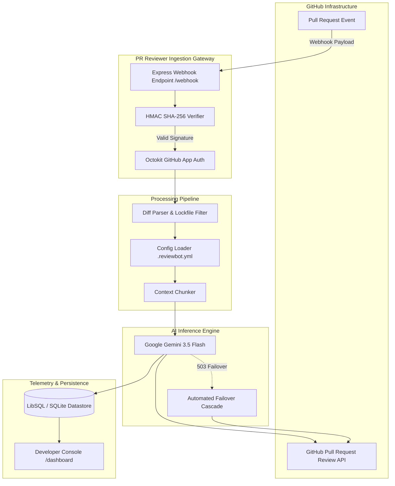

# PR Reviewer Bot

[](https://www.typescriptlang.org/)
[](https://nodejs.org/)
[](https://docs.github.com/en/rest)
[](LICENSE)

An enterprise-grade, event-driven GitHub App service providing automated code reviews on pull requests. Engineered with unified diff chunking, strict schema-constrained LLM inference via Google Gemini, multi-model failover, and persistent observability telemetry backed by SQLite.

---

## System Overview

Manual code review is often bottlenecked by syntax nits, surface-level oversights, and delayed feedback cycles. PR Reviewer Bot acts as an asynchronous review gate that runs immediately when a pull request is opened or updated (`pull_request.opened`, `synchronize`, `reopened`).

### Key Capabilities

- **Cryptographic Request Validation:** Verifies GitHub webhook deliveries using HMAC SHA-256 signatures via constant-time comparison (`crypto.timingSafeEqual`) on raw request buffers to prevent timing attacks.
- **Unified Diff AST Parsing & Filtering:** Parses raw git patches via `parse-diff` and filters non-actionable changes (lockfiles, minified bundles, asset binaries, source maps) before AI evaluation.
- **Intelligent Diff Chunking:** Splits oversized pull requests into context-bounded partitions (<30,000 characters) to avoid LLM context-window degradation and hallucinations.
- **Deterministic AI Review Engine:** Leverages the official `@google/genai` SDK with strict JSON schema constraints (`Type.OBJECT`) to generate structured findings across severity tiers: `CRITICAL`, `SUGGESTION`, and `NIT`.
- **Automated Upstream Failover:** Implements an automated model cascade (`gemini-3.5-flash` &rarr; `gemini-3.1-flash-lite` &rarr; `gemini-2.5-flash-lite` &rarr; `gemini-3.8-flash`) to ensure zero dropped reviews during provider capacity spikes.
- **Inline GitHub Review Publishing:** Submits findings directly to GitHub's Pull Request Review API (`octokit.rest.pulls.createReview`) with exact file paths, line numbers, and actionable remediation snippets.
- **Repository-Level Governance:** Respects per-repository configuration files (`.reviewbot.yml` or `.github/reviewbot.yml`) for custom rules, file exclusion patterns, and severity gating.
- **Telemetry & Developer Console:** Automatically records execution latency, defect counts, and review assessments into SQLite via `@libsql/client`, exposed through REST endpoints and an integrated SaaS console.

---

## Architecture



---

## Technical Specifications

| Component | Technology | Implementation Details |
| :--- | :--- | :--- |
| **Runtime** | Node.js / TypeScript | ES2022 target, strict type safety, ts-node runtime |
| **HTTP Layer** | Express 4.x | Raw buffer ingestion for webhooks, REST telemetry routes |
| **Authentication** | GitHub App (`@octokit/auth-app`) | RSA private key signing, installation token negotiation |
| **AI SDK** | `@google/genai` | Structured schema generation (`gemini-3.5-flash`) |
| **Diff Engine** | `parse-diff`, `minimatch` | Unified diff tokenization, glob-based pattern matching |
| **Persistence** | `@libsql/client` (SQLite) | Embedded SQLite (`reviews.db`) with automatic schema migration |
| **UI Layer** | Tailwind CSS + Chart.js | Server-rendered SaaS console with slide-over review drawer |

---

## Repository Configuration

Repositories can customize review behavior by adding `.reviewbot.yml` or `.github/reviewbot.yml` to the root of the repository:

```yaml
# .reviewbot.yml
severityThreshold: SUGGESTION # Minimum severity to post inline: CRITICAL | SUGGESTION | NIT
maxFilesToReview: 25          # Skip processing if modified file count exceeds limit

ignore:
  - "**/*.min.js"
  - "**/*.lock"
  - "dist/**"
  - "build/**"
  - "coverage/**"
  - "tests/fixtures/**"

customInstructions: >
  Enforce strict parameterized queries on all database operations.
  Disallow hardcoded credentials, JWT secrets, and API keys.
  Require explicit error handling on all asynchronous promise chains.
```

### Configuration Schema

| Key | Type | Default | Description |
| :--- | :--- | :--- | :--- |
| `severityThreshold` | `enum` | `"SUGGESTION"` | Minimum defect severity required to generate inline comments. Options: `CRITICAL`, `SUGGESTION`, `NIT`. |
| `maxFilesToReview` | `integer` | `30` | Safety ceiling to avoid excessive processing on large automated commits. |
| `ignore` | `string[]` | `[]` | Glob patterns of files to exclude from diff analysis in addition to built-in ignore lists. |
| `customInstructions` | `string` | `""` | Repository-specific guidance appended to the system review prompt. |

---

## Getting Started

### Prerequisites

- Node.js >= 18.0.0
- npm or pnpm
- A registered GitHub App with `Pull requests: Read & write` permissions
- Google Gemini API key

### 1. Installation

```bash
git clone <repository-url>
cd "PR Reviwer Bot"
npm install
```

### 2. Environment Configuration

Copy `.env.example` to `.env` and provide your credentials:

```bash
cp .env.example .env
```

```ini
# GitHub App Configuration
GITHUB_APP_ID=123456
GITHUB_PRIVATE_KEY_PATH=./private-key.pem
GITHUB_WEBHOOK_SECRET=your_webhook_secret

# AI Engine
GEMINI_API_KEY=your_gemini_api_key

# Network & Server
PORT=3000
NODE_ENV=development

# Webhook Tunnel (for local development)
SMEE_URL=https://smee.io/your_channel_hash
```

Place your GitHub App RSA private key at the path specified by `GITHUB_PRIVATE_KEY_PATH`.

### 3. Build & Run

```bash
# Development mode with Smee proxy
npm run dev

# Production build and execution
npm run build
npm start
```

---

## Observability & REST API

The service includes an embedded telemetry engine that tracks execution latencies, verdict distributions, and defect severity counts.

### Telemetry Endpoints

#### `GET /api/stats`
Returns aggregated performance metrics:
```json
{
  "totalReviews": 42,
  "changesRequested": 12,
  "approved": 28,
  "commentsOnly": 2,
  "totalComments": 86,
  "totalCritical": 14,
  "totalSuggestions": 48,
  "totalNits": 24,
  "totalRepos": 3,
  "avgDurationMs": 28450
}
```

#### `GET /api/reviews`
Returns recent review execution records with findings payloads, file paths, line numbers, and duration metadata.

#### `GET /dashboard`
Provides a server-rendered developer console featuring:
- Key performance indicator cards (Evaluated PRs, Critical Flaws Detected, Clean Pass Rate, Mean Latency).
- Interactive Chart.js telemetry charts tracking latency trends and defect severity distributions.
- Review audit log with real-time text searching and filter tabs (`Changes Requested`, `Approved`, `Has Critical`).
- Slide-over review inspection drawer with syntax-highlighted code diffs, defect lines, and remediation recommendations.

---

## Security & Failure Resilience

1. **Constant-Time HMAC Validation:** Webhook payloads are verified against the configured `GITHUB_WEBHOOK_SECRET` using `crypto.timingSafeEqual` over SHA-256 hashes, protecting against timing-based side-channel attacks.
2. **Provider Failover Cascade:** When upstream Google Gemini APIs encounter 503 capacity spikes or rate-limit saturation, the review engine automatically steps through a secondary model fallback chain without failing the webhook transaction.
3. **Graceful Network Reconnection:** Webhook event stream connections (e.g., Smee proxies) are guarded by global unhandled rejection handlers and retry listeners to survive transient network drops.
4. **Token Isolation:** Installation access tokens are ephemeral, requested per-installation from GitHub, and cached only for the duration of the review execution.

---

## License

This project is licensed under the MIT License. See [LICENSE](LICENSE) for details.
